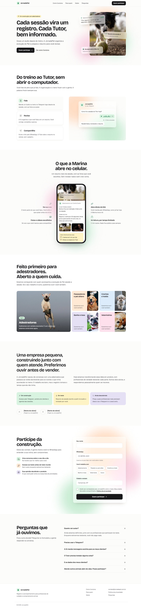
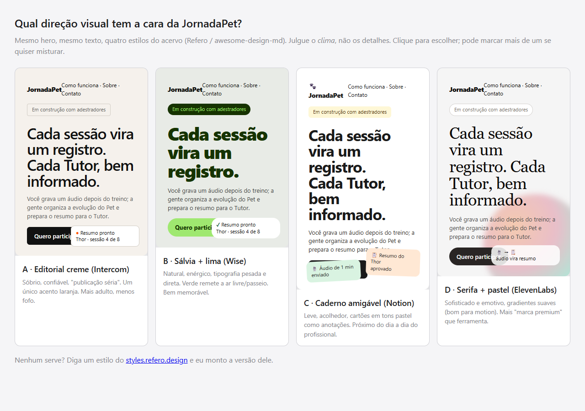
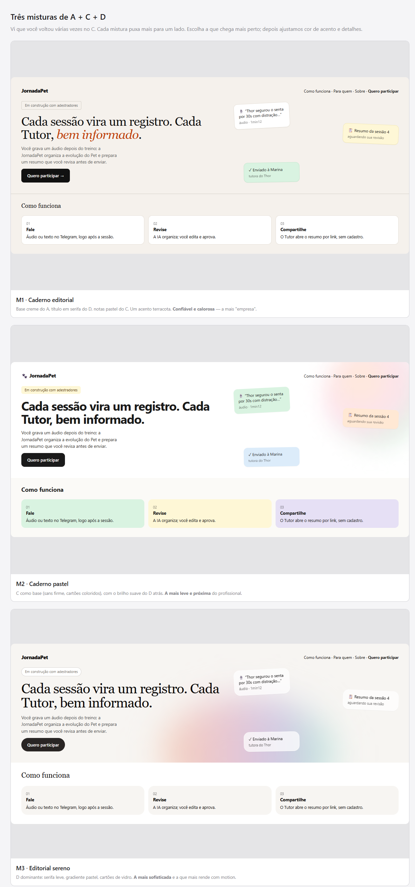
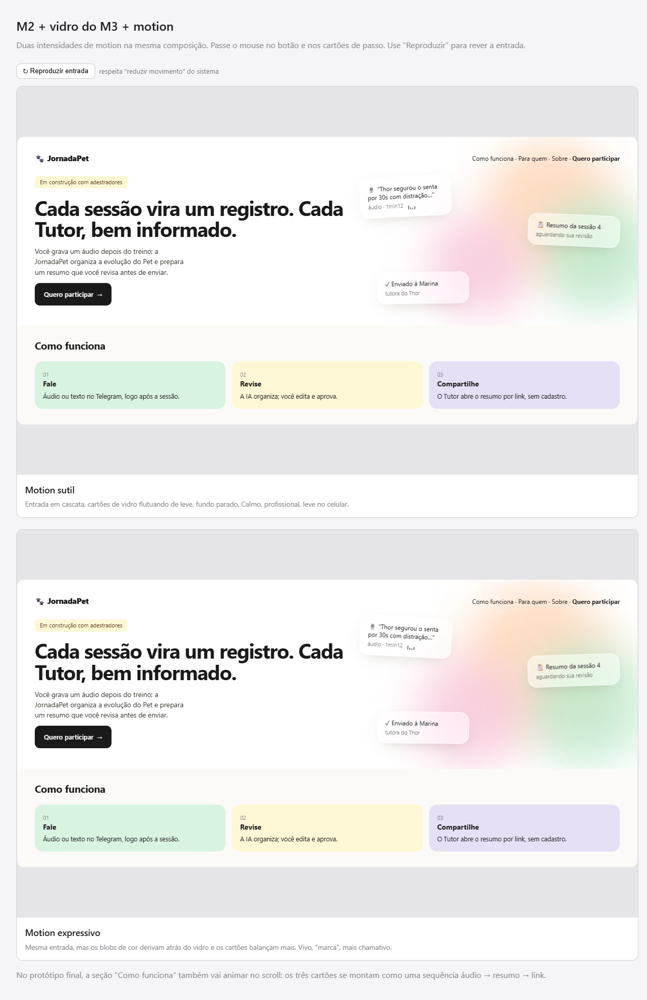
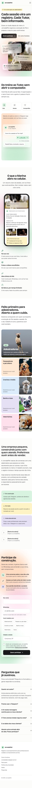
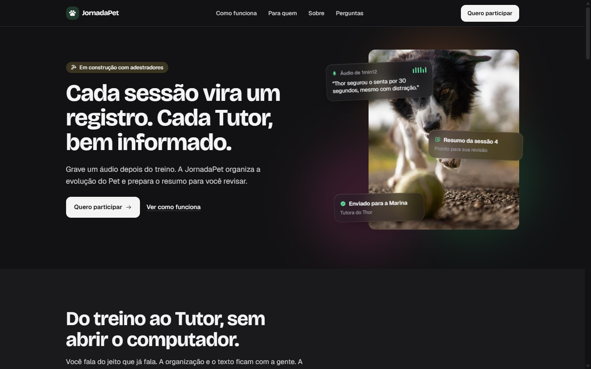
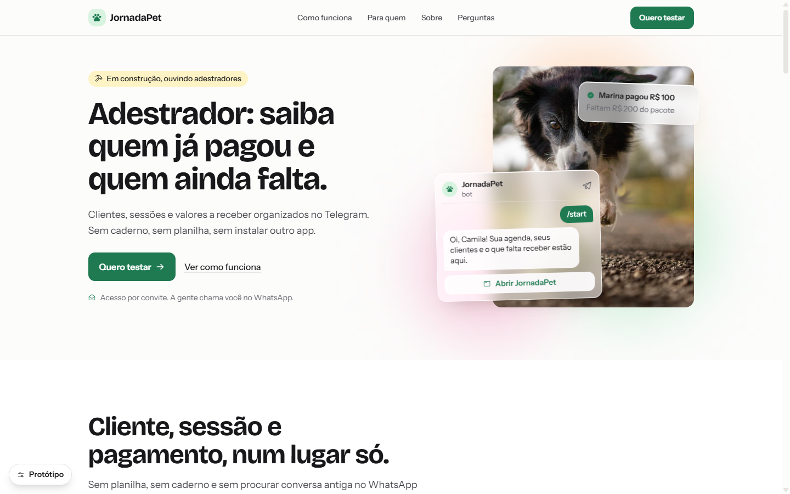
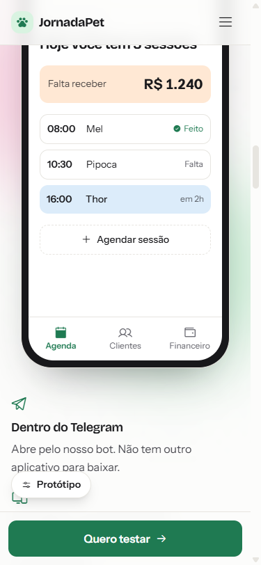
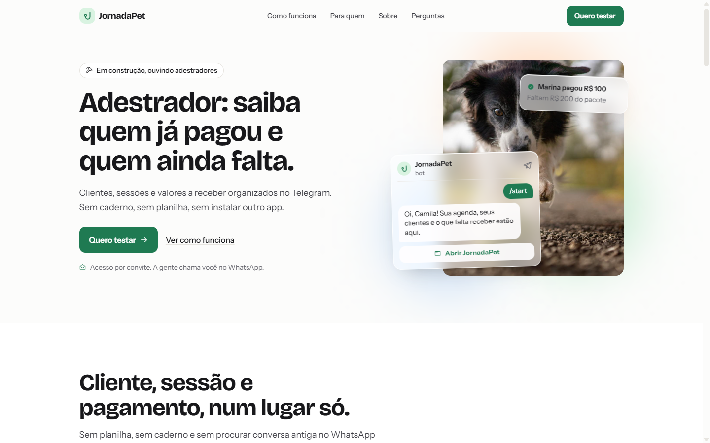
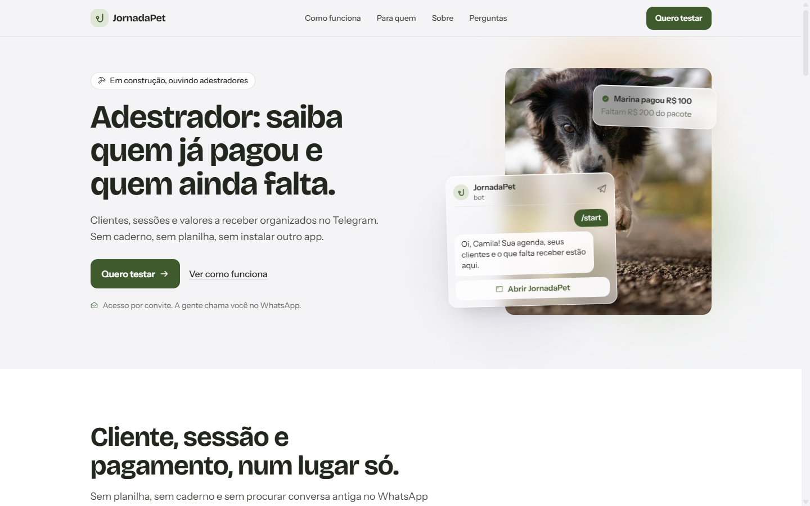

# NT-001 — Landing page da JornadaPet: direção visual, seções e protótipo

**Data:** 2026-10-11
**Versão:** nenhuma — protótipo, sem código de produto
**Arquivos:** `docs/notas-tecnicas/prototipos/NT-001-landing-page.html` (v1, histórico),
`docs/notas-tecnicas/prototipos/NT-001-landing-page-v2.html` (v2, vigente),
`docs/notas-tecnicas/prototipos/NT-001-assets/` (fotos do protótipo)

Protótipo vigente: [`prototipos/NT-001-landing-page-v2.html`](prototipos/NT-001-landing-page-v2.html) ·
v1: [`prototipos/NT-001-landing-page.html`](prototipos/NT-001-landing-page.html) ·
Origem do conteúdo: repositório [ArrayOf/jornada-pet](https://github.com/ArrayOf/jornada-pet)
(`discovery/`, `specs/` e `planejamento/versao-1/`) ·
Referências de estilo: [Refero Styles](https://styles.refero.design/) e
[`references/awesome-design-md/`](../../references/awesome-design-md/)

Links compartilháveis (claude.ai, privados até serem compartilhados pelo menu Share):
v2 <https://claude.ai/artifact/BrtZ8agaS62DGrbHwVaiem> · v1 <https://claude.ai/artifact/VRU8PiqxEZoqFk3Nm43s7C>.
A cópia publicada é gerada por [`prototipos/publicar_artifact.py`](prototipos/publicar_artifact.py)
(embute os ícones, adapta o tema ao visualizador; o protótipo em si não muda).

Spec: [`2026-10-11-landing-page-design.md`](../superpowers/specs/2026-10-11-landing-page-design.md) ·
Plano: [`2026-10-11-landing-page.md`](../superpowers/plans/2026-10-11-landing-page.md) ·
Design system: [`DESIGN.md`](../../DESIGN.md)

⚠️ **Nota escrita antes da implementação.** Registra as decisões tomadas sobre o protótipo, com o
motivo de cada uma, as direções descartadas e o que ficou em aberto.

## 0. O que mudou com a versão 1 do produto (v2 do protótipo)

Em 11/10/2026, depois da v1 do protótipo, os sócios publicaram o planejamento da
[versão 1](https://github.com/ArrayOf/jornada-pet/tree/main/planejamento/versao-1) do produto. A
primeira entrega é uma ferramenta de **gestão** no Telegram (Mini App): Conta por convite,
Carteira de clientes, Agendamento e Gestão financeira. **Registro de evolução, resumo para o Tutor
e a interface por áudio e IA ficaram para depois, sem data.**

A v1 do protótipo contava exatamente a história que saiu (áudio, resumo, Tutor). A decisão foi
**v1 do produto + faixa "em breve"**: a página fala do que a primeira entrega faz e mostra o resto
como "em estudo, sem data". O visual, o motion e os componentes não mudaram. O que mudou:

| Seção | v1 do protótipo | v2 do protótipo |
|---|---|---|
| Hero | "Cada sessão vira um registro. Cada Tutor, bem informado." Notas: áudio, resumo, enviado | "Clientes, agenda e cobranças do seu trabalho, no Telegram." Notas: sessão de hoje, ficha do Pet, R$ 100 recebido |
| Como funciona | Fale → Revise → Compartilhe | **Cadastre → Agende → Receba**: ficha do Pet com CEP, agenda do dia com estados e aviso de conflito, valor a receber quitado em dois pagamentos |
| 3ª seção | "O que a Marina abre no celular" (resumo para o Tutor) | **"O seu dia, aberto no Telegram"**: prévia do Mini App (agenda do dia, recebido e a receber) |
| Nova faixa | — | **"O que vem depois"**: pedir por áudio e resumo para o Tutor, marcados "Em estudo, sem data" |
| Sobre | "Em teste: resumo da sessão" | "Em construção: Telegram, carteira, agenda e valores a receber". "Em estudo: áudio e resumo" |
| Participe | "Acesso ao teste" | "O acesso é por convite", que é como a Conta funciona na v1 |
| Perguntas | Incluía "A IA manda mensagens?" e "O Tutor instala algo?" | Entram "Como eu entro?" (convite + SMS uma vez) e "Meus clientes recebem alguma coisa?" (não, na v1) |

As telas do Mini App no protótipo são **ilustrações**. As telas reais não foram desenhadas; os
dados mostrados (estados Agendado/Concluído/Falta, aviso de conflito, total recebido e saldo a
receber) existem nas PRDs, mas a home com indicadores não está especificada.

A hipótese de preço (gratuito com Carteira e Agenda; Premium a R$ 39,99 com Financeiro e IA) **não**
aparece na página, porque não está validada.

## 1. O que é

A página pública da JornadaPet, com dois objetivos ao mesmo tempo:

- **apresentar a empresa** — o que a JornadaPet faz, para quem e em que fase está;
- **captar profissionais interessados** — um formulário curto que alimenta as conversas e
  entrevistas previstas no roadmap do discovery.

O público é o **profissional** de cuidado e comportamento animal, e não o Tutor. O foco inicial é o
adestrador autônomo com carteira recorrente; os demais perfis aparecem como "queremos ouvir você
também". O texto não promete o que ainda é hipótese: preço não aparece, e a seção "Sobre" separa
o que está em construção, em teste e ainda em descoberta.

Stack combinada para a implementação: **Astro + Tailwind CSS + Alpine.js**, com motion design. O
protótipo já usa Tailwind (CDN `@tailwindcss/browser`) e Alpine (`x-data`, `x-intersect`,
`x-collapse`) com as mesmas classes e diretivas que irão para os componentes `.astro`, para que o
port seja mecânico.

## 2. Como abrir o protótipo

- Abre direto do disco no navegador. Precisa de internet só para fontes, Tailwind, Alpine e ícones
  (CDN); as fotos são locais, em `NT-001-assets/`.
- Para testar como site (ou pelo celular), sirva a pasta `prototipos/` com qualquer servidor
  estático, por exemplo `python -m http.server 8765`.
- O botão **Protótipo**, no canto inferior esquerdo, simula o que não depende de backend:
  - **Tema:** sistema, claro ou escuro;
  - **Envio do formulário:** sucesso, erro ou lento (4 s) e sucesso;
  - **Reduzir movimento** e **reduzir transparência**, sobrepondo a preferência do sistema.

  O painel não vai para o produto.

## 3. Direção visual

### 3.1 Como chegamos lá

A direção foi escolhida em três rodadas, com desenhos lado a lado e o mesmo hero e texto em todos:

| Rodada | Opções | Escolha |
|---|---|---|
| 1. Estilos de referência | A · Editorial creme (Intercom), B · Sálvia + lima (Wise), C · Caderno amigável (Notion), D · Serifa + pastel (ElevenLabs) | A, C e D — com preferência visível pelo C |
| 2. Misturas | M1 · Caderno editorial, M2 · Caderno pastel, M3 · Editorial sereno | **M2**, com os cartões de vidro do M3 |
| 3. Intensidade do motion | Sutil, Expressivo | **Meio-termo**: fundo vivo, cartões calmos |

### 3.2 Direções descartadas, e por quê

Quem for mexer na identidade de novo vai reabrir as mesmas opções; o motivo de cada queda está aqui.

- **B · Sálvia + lima (Wise).** Tipografia pesada e verde-lima memoráveis, mas lê como fintech;
  não foi escolhida na primeira rodada.
- **A · Editorial creme, isolado.** Confiável, mas "adulto" demais sozinho. Contribuiu para o M1.
- **D · Serifa + pastel, isolado.** Bonito e bom para motion, mas mais "marca premium" que
  ferramenta de trabalho. Contribuiu com os cartões de vidro.
- **M1 · Caderno editorial** (creme + serifa + notas pastel). Perdeu para o M2 por ser menos próximo
  do dia a dia do profissional. Além disso, o fundo creme e o título em serifa caem nas regras
  anti-padrão da skill `design-taste-frontend` (paleta creme + terracota e serifa como padrão
  "premium").
- **M3 · Editorial sereno.** Dele ficou só o vidro; a serifa leve e o gradiente dominante saíram.
- **Motion sutil** (fundo parado) e **motion expressivo** (cartões balançando muito). O meio-termo
  manteve o fundo vivo, que é o que faz o vidro aparecer, sem tirar a calma da leitura.

### 3.3 O que mudou entre os mockups do brainstorm e o protótipo

Os mockups do brainstorm eram esboços. No protótipo, as regras das skills de design instaladas no
projeto (`impeccable`, `design-taste-frontend`, `web-design-guidelines`) mudaram alguns detalhes —
sem mexer na direção escolhida:

- **Fontes.** Inter saiu (é o padrão genérico); entraram **Bricolage Grotesque** nos títulos —
  amigável e com personalidade — e **Instrument Sans** no texto. Ambas no Google Fonts. (A primeira
  versão usava Geist; o hook de design da `impeccable` apontou como fonte batida e ela foi trocada.)
- **Ícones.** Emoji não serve de ícone; entrou a biblioteca **Phosphor** (`@phosphor-icons/web`).
- **Texto sem travessão (—).** A skill de taste proíbe o travessão em qualquer texto visível; o
  protótipo não tem nenhum. (Esta nota, que não é página, segue o padrão das NTs.)
- **"Como funciona" não é uma fileira de três cartões iguais.** Virou o momento de motion da
  página: um passo a passo em que um cartão de vidro se transforma — áudio no Telegram, rascunho
  do resumo, link para o Tutor.
- **Hero com foto real.** "Texto + blob" não é hero; entrou uma foto (placeholder) com as notas de
  vidro por cima.
- **Modo escuro** e fallback para **reduzir transparência** (o vidro vira superfície sólida).

### 3.4 Tokens

Definidos como variáveis CSS em `:root` e redefinidos em `.dark`; o Tailwind os lê por
`@theme inline` (`bg-mint`, `text-ink`, `bg-accent`…).

| Papel | Claro | Escuro |
|---|---|---|
| Fundo / superfície | `#fcfcfb` / `#ffffff` | `#121214` / `#1a1a1d` |
| Texto forte / corpo / apagado | `#18181b` / `#3f3f46` / `#63636b` | `#f4f4f5` / `#cfcfd4` / `#a0a0a8` |
| Linha | `#e7e5e0` | `#2b2b30` |
| Acento (único) | `#1f7a52` — verde | `#5fd39a` |
| Pastéis de superfície | menta `#d9f3e1`, manteiga `#fef3c4`, pêssego `#ffe8d4`, céu `#dcecfa`, lilás `#e6e0f5`, rosa `#fde0ec` | versões escuras e dessaturadas |
| Blobs atrás do vidro | `#ffd6b8`, `#bfe9cc`, `#f7c9dc` (opacidade .85) | `#6b3d22`, `#1f5a3a`, `#5a2440` (opacidade .55) |
| Botão principal | fundo `#18181b`, texto `#fcfcfb` | invertido |

- **Um acento só** (verde), usado em ícones, foco, confirmações e no botão "Aprovar". Os pastéis
  são superfícies, não acentos.
- **Escala de tipo:** 12, 14, 16, 18, 20 e 28 px, mais os títulos em `clamp()`. A primeira versão
  tinha 12 tamanhos próximos; o hook de design apontou hierarquia achatada.
- **Raios:** cartões 16 px, controles (botões, campos) 12 px, chips e selos em pílula.
- **Vidro:** `rgba(255,255,255,.58)`, `backdrop-filter: blur(16px) saturate(140%)`, borda de 1 px
  clara e realce interno. Sólido com `prefers-reduced-transparency`.

### 3.5 Motion

| Onde | O quê | Por quê |
|---|---|---|
| Hero | Entrada em cascata do texto; notas de vidro "pousando" uma a uma | Hierarquia: primeiro a promessa, depois a prova |
| Hero e "Participe" | Blobs de cor derivando devagar (16–23 s) atrás do vidro; notas flutuando 5 px | É o que faz o vidro parecer vidro — o meio-termo escolhido |
| Nota de áudio | Barras da onda pulsando | Indica "áudio" sem texto |
| Como funciona | Troca de estado do palco (blur + deslocamento) e barra de progresso de 6 s por passo | Conta a sequência áudio → resumo → link |
| O que o Tutor recebe, Para quem | Revelação escalonada no scroll (`x-intersect`) | Só nessas duas seções, para não virar efeito repetido |
| Botões | Elevação de 2 px no hover, compressão no clique | Resposta tátil |

Com **reduzir movimento**, nada anima e o passo a passo não avança sozinho. O passo a passo também
pausa com o mouse em cima ou com o foco do teclado dentro, e tem botão de pausar e retomar.

## 4. Seções

Oito seções, aprovadas na ordem abaixo. Cada uma usa uma composição diferente, para a página não
repetir o mesmo layout.

| # | Seção | Composição | Conteúdo |
|---|---|---|---|
| 1 | Hero | Texto à esquerda, foto com notas de vidro à direita | Selo "Em construção com adestradores", promessa, botão **Quero participar** |
| 2 | Como funciona | Passos clicáveis + palco com cartão que se transforma | Fale → Revise → Compartilhe |
| 3 | O que o Tutor recebe | Celular no centro, quatro destaques ao redor | Prévia real do resumo da sessão |
| 4 | Para quem | Bento: adestradores em destaque + quatro perfis | Passeadores, creches e hotéis, banho e tosa, veterinários |
| 5 | Sobre | Declaração grande, dois parágrafos, três blocos de estado, sócios | "Em construção", "Em teste", "Ainda descobrindo" |
| 6 | Participe | Benefícios à esquerda, formulário em vidro à direita | Nome, WhatsApp, perfil, cidade, aceite |
| 7 | Perguntas | Título fixo à esquerda, acordeão à direita | Preço, Telegram, IA, Tutor, dados, outros animais |
| 8 | Rodapé | Marca + links | Contato e política de privacidade |

### 4.1 Formulário

- **Campos:** nome, WhatsApp com máscara `(11) 98765-4321`, perfil (um entre seis chips), cidade e
  estado, e aceite de contato. Mais um campo-isca invisível contra robôs.
- **Validação:** no blur de cada campo e no envio. A mensagem fica abaixo do campo, e o foco vai
  para o primeiro campo com problema, na ordem da tela.
- **Estados:** enviando ("Enviando…", botão desabilitado), sucesso (agradece pelo primeiro nome e
  repete o WhatsApp) e erro (os dados continuam preenchidos e aparece um e-mail alternativo).
- **Um único rótulo de ação na página toda:** "Quero participar" (menu, hero e formulário).
- O protótipo **simula** o envio. O serviço de destino é decisão da spec (§6).

## 5. Verificação feita

- **Telas:** desktop 1440 px e celular 375 e 390 px, sem rolagem horizontal. O rodapé estourava no
  celular com o e-mail longo em duas colunas e passou a ter uma coluna só.
- **Título do hero:** 3 linhas no desktop. Estava em 4; a escala foi reduzida.
- **Modo escuro e reduzir movimento:** zero animações com `prefers-reduced-motion: reduce`.
- **Formulário:** todas as mensagens de validação aparecem, o foco cai no primeiro erro e, no envio
  com erro, os dados são mantidos.
- **Revisão pelas Web Interface Guidelines** (skill `web-design-guidelines`). Corrigidos:
  - foco no primeiro erro;
  - `aria-live` nas mensagens e `aria-invalid` e `aria-describedby` em rádios e checkbox;
  - `name` e `type="tel"` nos campos;
  - pausa do passo a passo e `tabindex` nos painéis;
  - `width`, `height` e `loading="lazy"` nas imagens;
  - `scroll-padding-top` para o cabeçalho fixo;
  - `theme-color`, `translate="no"` na marca, rótulo do menu (abrir ou fechar) e aspas tipográficas.
- **Console** sem erros.

## 6. Em aberto — para a spec

1. **Serviço do formulário.** Web3Forms, Formspree ou Google Sheets via Apps Script. Pesam a cota
   gratuita, o destino dos dados (LGPD) e o aviso por e-mail ou WhatsApp a cada inscrição.
2. **Hospedagem e domínio.** Cloudflare Pages, Netlify ou Vercel. O domínio
   `jornadapet.com.br`, usado no protótipo, não foi confirmado.
3. **Fotos próprias.** As fotos atuais são do placedog.net, sem licença para uso comercial e sem
   adestrador em cena. A página precisa de: hero (5:6), destaque de adestradores (1:1), quatro
   perfis (1:1) e duas fotos de sessão (4:3). O ideal é foto real de sessão de adestramento.
4. **Sobre:** nomes, fotos e papéis dos dois sócios.
5. **E-mail de contato** e **política de privacidade**: `contato@jornadapet.com.br` e o link "#" são
   provisórios.
6. **Textos que prometem algo e precisam de confirmação dos sócios:**
   - "Sem custo enquanto estivermos testando";
   - "Somos dois sócios, e respondemos pessoalmente quem se inscreve";
   - "Vamos chamar você no WhatsApp nos próximos dias";
   - "Válido por 7 dias" no link do resumo. A PoC fala em link temporário, sem prazo definido.
7. **Logo.** Hoje é a pata do Phosphor num quadrado menta, mais o nome em Bricolage. Serve até
   existir uma marca.
8. **Itens "bom ter" da revisão que ficam para a implementação:**
   - prender o foco no menu do celular e devolvê-lo ao botão ao fechar;
   - o acordeão e o menu respeitarem "reduzir movimento" (o `x-collapse` não respeita sozinho);
   - `preload` da fonte do título;
   - deep-link do passo e da pergunta abertos.
9. **Animações contínuas.** Os blobs e a flutuação das notas não têm botão de pausa, só respeitam
   "reduzir movimento". São decorativas e lentas; a spec decide se isso basta.

## 7. Para o port em Astro

- Um componente por seção (`Hero.astro`, `ComoFunciona.astro`, `TutorRecebe.astro`,
  `ParaQuem.astro`, `Sobre.astro`, `Participe.astro`, `Perguntas.astro`, `Rodape.astro`).
- `Layout.astro` concentra `<head>`, fontes, tokens e o tema.
- Tokens e `@theme` vão para o CSS global do Tailwind. O protótipo usa o build de navegador do
  Tailwind 4; no Astro entra o plugin `@tailwindcss/vite`.
- O `x-data` de `stepper()` e de `form()` vira módulo JS registrado com `Alpine.data(...)`. Os
  plugins `intersect` e `collapse` entram pela integração `@astrojs/alpinejs`.
- Atenção a uma armadilha encontrada no protótipo: com `@theme inline`, as variáveis `--font-*` não
  existem em `:root`, e o Tailwind anula `--font-display` e `--font-sans` declaradas à mão. Por
  isso as fontes ficam em `--f-display` e `--f-sans`.
- Outra armadilha: o Alpine **remove** o atributo quando o valor ligado é `false`. Um seletor
  `[data-on="false"]` nunca casa. Use `String(...)`.
- O painel "Protótipo" não entra.

## 8. Revisão por especialistas (v2 do protótipo)

Em 11/10/2026 o protótipo v2 passou por quatro revisões independentes: SEO, UX, marketing e
design visual. Abaixo, a consolidação. O peso de cada item vem de quantos revisores chegaram nele
por caminhos diferentes. Os relatórios completos não foram versionados; esta lista é a referência.

### 8.1 Consenso (dois ou mais revisores)

| Achado | Quem apontou | Encaminhamento |
|---|---|---|
| "Cobranças" no título promete o que a v1 não faz (só registra valores; não cobra) | UX, Mkt | Trocar por "valores a receber" / "quem já pagou" |
| "Adestrador" não aparece no título nem no subtítulo | SEO, UX, Mkt | Título com o público, ex.: "Adestrador: saiba quem já pagou e quem ainda falta." |
| No celular, ~7.000 px sem nenhum botão de ação entre o topo e o formulário | UX, Design | CTA fixo no celular e CTA depois de "Como funciona" |
| Fotos do placedog sem profissional em cena | SEO, Mkt, Design | Fotos documentais do adestrador trabalhando (ou ilustração de traço até lá) |
| Placeholders dos sócios enfraquecem a confiança | SEO, Mkt, Design | Fotos e nomes reais, ou o bloco sai até existirem |
| Política de privacidade é `#` e o formulário coleta WhatsApp | SEO, UX, Mkt | Página `/privacidade` real antes de publicar (LGPD) |
| WhatsApp é o canal nativo do público; e-mail não | UX, Mkt | Link wa.me como alternativa ao formulário e na mensagem de erro |
| "Queremos ouvir você também" repetido; Para quem longo no celular | Mkt, Design | Uma vez só; compactar; considerar tirar Veterinários (doc 02) |
| Totais mensais e aviso de conflito detalhado no mock vão além das PRDs | Mkt | Mostrar só "A receber"; aviso genérico de sobreposição |

### 8.2 Correções sem decisão de produto

- Máscara do WhatsApp quebra ao colar "+55 11 ..." (vira número errado sem erro).
- "Pergunte no formulário" no FAQ, mas o formulário não tem campo de pergunta.
- Painéis inativos do passo a passo com `aria-hidden` e `tabindex="0"`: usar `inert`.
- Passo a passo sem troca automática no celular.
- Alvos de toque de 44 px nos chips de perfil e no aceite; texto mínimo de 14 px nos exemplos.
- Reticências nos placeholders saem; "Veterinária" e "Veterinários" unificados.
- Títulos `<h3>` dentro dos exemplos (Thor, terça, pacote) viram texto comum; exemplos marcados como ilustração.
- Chip "Agora" ilegível no modo escuro.
- Rodapé ainda fala em "registro e acompanhamento" (escopo adiado).
- Honeypot fora da tela em vez de `display:none`.

### 8.3 Para o port em Astro (SEO e performance)

- Conteúdo hoje gerado por Alpine (`x-for`/`x-text`: passos, FAQ, cartões do Para quem, opções do
  formulário) precisa estar no HTML estático. FAQ com `
`.
- Formulário com `action` real, funcionando sem JS; campos ocultos de `utm_*` e `ref`.
- `<title>`, description, canonical, Open Graph e Twitter card com imagem 1200×630, JSON-LD
  `Organization` e `WebSite` (sem `SoftwareApplication` antes do lançamento), sitemap, robots,
  favicon e manifest, `noindex` em staging.
- Tailwind em build, fontes auto-hospedadas com `preload`, ícones em SVG, imagens AVIF/WebP, sem
  fade no elemento de LCP, blobs mais leves no celular.

### 8.4 Decisões que dependem dos sócios

1. Título do hero (opções do marketing: A "Adestrador: saiba quem já pagou e quem ainda falta.",
   B "O caderno do adestrador, agora no seu celular.", C "Agenda e recebimentos em ordem, sem largar
   o WhatsApp."). Alerta: se o freemium for adiante, o Financeiro é Premium.
2. Rótulo do botão: "Quero participar", "Quero testar" ou "Pedir meu convite".
3. "Sem custo durante o teste" e a oferta de cadastrar os primeiros clientes junto, numa chamada.
4. Número de WhatsApp da empresa, quem responde e em quanto tempo.
5. Campo opcional "Como você organiza hoje?" ou "Já usa Telegram?" no lugar de cidade.
6. Identidade: logo próprio (hoje é a pata do Phosphor), verde no botão principal, pastel com
   significado fixo por área, mostrar a conversa com o bot do Telegram no hero.
7. Abordar o Marcos (autorização para citar, live) e escolas de formação como primeiro canal.

### 8.5 Pontos em que a revisão contraria decisões já tomadas

- O design sugere fundir a faixa "Em breve" no Sobre; a faixa foi escolha explícita do cliente.
  Mantida, com o texto ajustado ("O que estamos estudando").
- O design aponta as pílulas acima dos títulos e os três blocos do Sobre como padrões proibidos
  pelas skills; as pílulas foram aprovadas nos mockups. Fica para decisão do cliente.

## 9. Aplicado depois da revisão (v2, 11/10/2026)

Decisões do cliente sobre a §8.4: **título A**, **"Quero testar" + "Pedir meu convite"**, e dois
movimentos de identidade, **conversa do Telegram no hero** e **verde no botão principal**.

- **Hero:**
  - Título: "Adestrador: saiba quem já pagou e quem ainda falta."
  - Subtítulo: "Clientes, sessões e valores a receber organizados no Telegram. Sem caderno, sem
    planilha, sem instalar outro app."
  - Linha de apoio: "Acesso por convite. A gente chama você no WhatsApp."
  - Selo: "Em construção, ouvindo adestradores".
  - Cartões: os três soltos deram lugar a uma conversa com o bot (`/start` e o botão "Abrir
    JornadaPet") e a uma nota "Marina pagou R$ 100". A conversa mostra só o que a v1 faz (o
    `/start` oferece o botão do Mini App, conforme `discovery/07`). Lembretes e mensagens
    automáticas do bot estão fora da v1 e não aparecem.
- **Botão principal** em verde `#1f7a52` (escuro: `#5fd39a`); chips de perfil marcados também em
  verde.
- **Botão fixo no celular**, que some quando o botão do hero ou o formulário estão na tela, e um
  segundo botão depois de "Como funciona".
- **Como funciona:**
  - Título: "Cliente, sessão e pagamento, num lugar só."
  - O passo "Receba" virou "Acompanhe".
  - Aviso de conflito genérico, como na PRD.
  - Troca automática só no desktop.
  - Painéis inativos com `inert`.
- **Prévia do Mini App:** só "Falta receber". O total mensal saiu, porque a consulta ainda está
  em aberto na PRD 0004.
- **Para quem:**
  - Cada cartão leva ao formulário com o perfil já marcado.
  - A frase repetida saiu.
  - Alt vazio nas fotos ilustrativas.
  - Cartões mais baixos no celular.
  - Chip "Agora" legível no escuro.
- **"O que estamos estudando"** no lugar de "O que vem depois", e sem "faz o resto".
- **Sobre:** título encurtado para "Uma empresa pequena, que prefere ouvir antes de vender."
- **Formulário:**
  - Botão "Pedir meu convite", com "A gente chama você no WhatsApp." abaixo.
  - A máscara aceita "+55" colado.
  - Alvos de toque de 44 px; placeholders sem reticências; honeypot fora da tela.
- **Dúvidas comuns:**
  - Novas: "Meus clientes precisam usar o Telegram?" e "Serve para mensalidade e aula avulsa?".
  - O convite a "perguntar no formulário" saiu.
- **Rodapé, `<title>` e description** alinhados à v1 e ao público.

**Não aplicado, e por quê:**
- **Texto mínimo de 14 px nos exemplos.** Quebraria a escala de tipo; os exemplos são
  ilustração.
- **Fundir "Em breve" no Sobre.** A faixa foi escolha do cliente.
- **Tirar as pílulas acima dos títulos.** Aprovadas nos mockups; ficam para decisão do cliente.
- **Logo próprio e pastel com significado fixo.** Não escolhidos agora.
- **Os itens da §8.3** são do port em Astro.

**Continua dependendo dos sócios (§8.4):**
- "sem custo durante o teste";
- número de WhatsApp da empresa e prazo de resposta;
- campo "Como você organiza hoje?";
- política de privacidade;
- fotos e nomes reais;
- abordagem do Marcos.

## 10. Análise de branding (11/10/2026)

Revisão de marca feita sobre o protótipo v2, com base no discovery (visão de negócio, públicos,
precificação, entrevista com o Marcos) e no escopo da versão 1.

### 10.1 Diagnóstico

- **O que a página comunica hoje:** amigável, leve, startup genérica.
- **O que deveria comunicar:** prática, confiável com dinheiro, do ofício (de colega).
- **Notas:**
  - **Distintividade 4/10.** A pata do Phosphor, os pastéis e o vidro são a linguagem padrão dos
    SaaS atuais.
  - **Coerência 6/10.** "JornadaPet" e "Jornada Pet" convivem; o logo muda de cor no escuro.
  - **Adequação 6/10.** A voz acerta; o visual tende ao "fofo" para um público que, segundo a
    percepção do Marcos, tem pouca intimidade com tecnologia e muitas vezes vem da polícia ou dos
    bombeiros.

### 10.2 Estratégia proposta

- **Essência:** o dia de trabalho do adestrador em ordem, no celular que ele já usa.
- **Promessa:** "Você cuida do cão. A JornadaPet lembra quem falta pagar."
- **Personalidade:** prática (e não "inovadora"), parceira de ofício (e não fofa), precisa com
  dinheiro (e não fintech), honesta sobre a fase (e não hype).
- **Territórios:**
  - **"O caderno do adestrador"** (principal). Conversa com a direção "caderno pastel".
  - **"Trajeto"** (visual): guia, percurso, cada ponto é uma sessão.
  - **"Conta em dia"** (benefício emocional).

### 10.3 Nome e arquitetura

- **Grafia pública única: "JornadaPet"**, no feminino ("a JornadaPet"). "Jornada Pet" fica só em
  documentos internos antigos.
- **"Jornada" é lido como jornada de trabalho.** Assim a v1 ainda cabe no nome; quando vier o
  Registro de evolução, o nome passa a valer também para a jornada do Pet.
- **Produto independente, com endosso discreto:** "JornadaPet é um produto da ArrayOf". Sem
  marca-mãe "Jornada" por enquanto (genérica, difícil de proteger, só com evidência de segunda
  vertical).
- **Checar antes de investir no logo:**
  - INPI: "JornadaPet", "Jornada Pet" e "Jornada", nas classes 9, 42 e 35;
  - Registro.br;
  - @ do bot no Telegram e @ no Instagram.

  Nenhum resultado foi afirmado.

### 10.4 Identidade visual

- **Símbolo próprio no lugar da pata.** Conceitos:
  - **A. "J-guia":** J monolinear cujo gancho termina numa argola de mosquetão.
  - **B. "Plaqueta":** plaqueta de identificação com J vazado.
  - **C. Wordmark:** "jornadapet" em Bricolage redesenhada, com "pet" em verde e o pingo do "j"
    virando check.

  O analista recomenda A ou C; o B prende a marca ao pet.
- **Verde vira cor da marca** (logo, botão, "pago", confirmações). Nunca azul, para não se
  confundir com o Telegram.
- **Pastéis com papel fixo:** menta para clientes, céu para agenda, manteiga para a receber,
  pêssego para falta ou atraso, lilás para "em estudo". Rosa sai.
- **Tipografia e iconografia:** Bricolage e Instrument mantidas; wordmark contornado; números
  tabulares em R$. Phosphor só na interface, num peso único.
- **Fotografia:** sessão real com luz natural, mãos, guia, petisco, celular. Ilustração de traço
  único enquanto não houver fotos próprias.
- **Telegram:**
  - avatar do bot com o símbolo sobre menta;
  - username terminando em "bot" (ex.: @JornadaPetBot, se livre);
  - o Mini App respeita o tema do usuário.

### 10.5 Voz e tom

- **Princípios:** falar do ofício, não da tecnologia; frases curtas com "você" e "a gente";
  afirmar só o que existe; adestrador como profissional, tutor como cliente dele.
- **Trocas sugeridas:**
  - "Aberto a quem cuida." → "Passeador, creche ou banho e tosa? Fale com a gente."
  - "Sua opinião decidindo o produto" → "Você ajuda a decidir o que vem primeiro."
  - "Participe da construção." → "Teste antes de todo mundo."
  - "mini app" no exemplo → "JornadaPet".
- **Usar:** clientes; quem já pagou; quem ainda falta; valor a receber; pagamento; aula ou
  sessão (testar as duas: o Marcos diz "aula"); convite; tutor e pet em minúsculas no texto
  corrido.
- **Evitar:** cobrança/cobrar; plataforma, solução, gestão, CRM, leads, dashboard; IA em
  destaque; "patudo"; "rastrear".

### 10.6 Pontos de contato

- **Bot:**
  - About: "Clientes, agenda e valores a receber do adestrador, aqui no Telegram. Acesso por
    convite."
  - `/start` com conta e sem conta, este último apontando para o site.
- **Imagem de compartilhamento** (1200×630): menta, símbolo, título e a bolha "Marina pagou
  R$ 100", tudo centralizado.
- **Instagram:** bio de ofício e conteúdo útil, não só produto.
- **WhatsApp Business** da empresa e assinatura dos sócios.
- **Rodapé** com o endosso da ArrayOf.

### 10.7 Tensão com decisões anteriores

O diagnóstico de "fofo" pesa contra a direção "caderno pastel" com vidro, que foi aprovada. O
analista não pede para trocá-la. Pede para equilibrá-la com sobriedade de ferramenta: verde mais
presente, cor com significado, símbolo próprio e fotos de ofício no lugar de cães de banco de
imagem.

### 10.8 Aplicado no protótipo

Decisões do cliente sobre a análise:

- **"JornadaPet" com endosso da ArrayOf.**
- **Símbolo A ("J-guia").**
- **Pastéis com significado fixo.**
- **"Sessão"** como termo público (como nas PRDs).

O que mudou:

- **Símbolo "J-guia" no lugar da pata do Phosphor:** menu, rodapé, avatar do bot na conversa do
  hero, cabeçalho do Mini App e favicon (SVG embutido).
  - Desenho: um J de traço único, `stroke-width` 3,2 e pontas arredondadas, cujo gancho termina
    numa argola (o mosquetão da guia), em `viewBox="-1.75 -1 26 32"`.
  - Cores fixas nos dois temas: argola e traço `#1f7a52` sobre `#d9f3e1`.
  - **É esboço para orientar o designer, não a marca final.**
- **Pastéis com papel fixo:**
  - menta para clientes (ficha "Ativo");
  - céu para agenda (passo "Agende", sessão "Agendado");
  - manteiga para a receber e atenção (passo "Acompanhe", "Falta receber", aviso de conflito);
  - pêssego para falta (estado "Falta");
  - lilás para "em estudo" (selo da faixa e bloco do Sobre).

  Rosa saiu (e o blob rosa virou céu). O que não é área do produto ficou neutro: selo do hero,
  cartões de perfil do "Para quem", blocos "Em construção" e "Ainda descobrindo" do Sobre, ícones
  dos benefícios do Participe. "Concluído" usa o verde da marca.
- **Rodapé:** "JornadaPet é um produto da ArrayOf." e "© 2026 ArrayOf".
- **Voz:**
  - "Feito primeiro para adestradores." com "Passeador, creche ou banho e tosa? Fale com a gente
    também.";
  - "Teste antes de todo mundo.";
  - "Você ajuda a decidir o que vem primeiro";
  - "mini app" saiu do exemplo;
  - tutor e pet em minúsculas no texto corrido. Rótulos de campo como "Tutora" continuam.

**Para o port em Astro:** a revelação no scroll (`data-reveal`) esconde o conteúdo até o
`IntersectionObserver` disparar. Se o JS falhar ou demorar, os cartões do "Para quem" e os
destaques da prévia ficam invisíveis. No port, o estado padrão deve ser **visível**, e a animação
só deve ser aplicada depois que o observador estiver ativo, ou feita com CSS `animation-timeline:
view()`.

### 10.9 Sócios

Nomes informados pelo cliente em 11/10/2026: **Mario Guedes** e **Thiago Filadelfo**. No Sobre, cada
um aparece com as iniciais num círculo menta, e a linha comum é "Sócios da ArrayOf". **Continuam
pendentes:**

- ~~fotos~~ resolvido: as fotos do LinkedIn foram baixadas para `NT-001-assets/socio-mario.jpg`
  e `socio-thiago.jpg` (400×400), porque as URLs do LinkedIn expiram. No port, gerar versões
  otimizadas (AVIF/WebP, 112 px para tela 2x);
- o papel de cada um na JornadaPet, que não foi informado e não foi inventado;
- ~~LinkedIn~~ resolvido: os nomes levam ao LinkedIn de cada um
  (`https://www.linkedin.com/in/jmarioguedes/` e `https://www.linkedin.com/in/trfiladelfo/`). No port, os dois entram no JSON-LD como `founder`
  (`Person` com `sameAs` apontando para o LinkedIn) da `Organization`.

### 10.10 ArrayOf

Site informado pelo cliente: `https://arrayof.com.br`. O nome "ArrayOf" vira link no rodapé ("JornadaPet é um
produto da ArrayOf.") e no Sobre ("Sócios da ArrayOf"). No port, a `Organization` do JSON-LD da
JornadaPet aponta para a ArrayOf como `parentOrganization`.

## 11. Paleta E: oliva e caramelo (11/10/2026)

O cliente trouxe ilustrações 3D de um adestrador (colete verde-oliva, calça cáqui, cinto de couro,
apito) e de um cão caramelo **como referência de cor**. As ilustrações não entram na página: a
foto do hero continua a mesma. Foram comparadas três paletas tiradas do uniforme ("Campo",
"Campo sóbrio") e duas com o caramelo ("D" sobre areia, "E" sobre neutro). O cliente escolheu a
**E**.

| Papel | Claro | Escuro | Origem |
|---|---|---|---|
| Fundo / superfície | `#f4f4f6` / `#ffffff` | `#151613` / `#1d1f1a` | cinza-lavanda do estúdio das ilustrações |
| Texto forte / corpo / apagado | `#23251f` / `#45473f` / `#676a60` | `#f1f2ec` / `#cfd1c7` / `#a0a395` | |
| Linha | `#e2e2e6` | `#2e3128` | |
| **Acento e botão (única cor de ação)** | **oliva `#3f5a2c`** | **`#a3c47f`** | colete e boné |
| Caramelo | `#d17c3a` (só ilustração e destaque; **nunca texto**: 2,8:1) | `#e09a5f` | pelo do cão |
| Clientes (menta) | `#e1e7d6` | `#283222` | sálvia do colete |
| Agenda (céu) | `#e0e0ea` | `#282a33` | fundo do estúdio |
| A receber (manteiga) | `#f2e2cf` | `#3a2e20` | caramelo claro |
| Falta (pêssego) | `#efdcd2` | `#3a2823` | terracota clara |
| Em estudo (lilás) | `#e7e4ec` | `#2d2a33` | |
| Blobs | `#ecd2b2`, `#cdd6bd`, `#dcdce6` | `#5c3f22`, `#34452a`, `#2c2d3a` | caramelo, sálvia, lavanda |
| Símbolo (fixo nos dois temas) | traço `#3f5a2c` sobre `#e1e7d6` | igual | |

**Contraste (WCAG):**

| Combinação | Claro | Escuro |
|---|---|---|
| Texto forte / fundo | 14,1:1 | 16,1:1 |
| Corpo / fundo | 8,6:1 | 11,8:1 |
| Apagado / fundo | 5,0:1 | 7,1:1 |
| Texto do botão / botão | 7,7:1 (branco sobre oliva) | 8,6:1 |
| Oliva sobre menta | 6,1:1 | — |

O verde-esmeralda `#1f7a52` saiu. Isso também resolve o "fofo" apontado pelo branding: os pastéis
ficaram mais terrosos e o acento ficou com cara de ofício.

As skills de design consideram "fundo quente + texto café" um clichê. Esta paleta não cai nele: o
fundo é neutro, e as cores vêm de uma referência trazida pelo cliente.

**Mascote:** fica registrado só como ideia, não decidido. Se for retomado, é preciso confirmar o
direito de uso das imagens (geradas por IA?) e fixar um único personagem: as duas versões do
adestrador são diferentes.

## 12. Depois do protótipo

- **`DESIGN.md`** na raiz da landing: tokens da paleta E, tipografia, raios, componentes e regras
  (Voz Única, Cor que Ensina, Caramelo Mudo, Sem Travessão, Vidro com Motivo, Movimento Calmo).
  Substitui, para a landing, o `DESIGN.md` do repositório do produto.
- **Revelação no scroll corrigida nos dois protótipos:** os elementos só deslizam e nunca ficam
  invisíveis esperando o scroll (o risco da §10.8 deixou de existir).
- **Protótipos publicados** como Artifact (links no topo desta nota).
- **Spec e plano** escritos (links no topo).

## 13. Implementação (12/10/2026)

Branch `feat/landing-page`, executada pelo [plano](../superpowers/plans/2026-10-11-landing-page.md)
em 12 tarefas com TDD. Astro 7.3.5, Tailwind 4.3.3, Alpine 3.17.4.

- **Testes:** Vitest com 55 testes (WhatsApp, validação, origem UTM, envio, conteúdo, JSON-LD) e
  Playwright com 74 testes em desktop e celular. Mais 6 pulados de propósito, por regra de
  plataforma: troca automática só no desktop, barra fixa só no celular. Incluem envio sem JS até
  `/obrigado`, axe WCAG 2.2 AA nos dois temas, nenhum travessão, reduzir movimento e
  transparência, e 375 px sem rolagem horizontal.
- **Lighthouse (celular):**
  - Acessibilidade 100 e Boas práticas 100.
  - SEO 69, só por causa do `noindex` proposital fora de produção.
  - Trace em 4G lenta com CPU 4×: **LCP 1,77 s** e **CLS 0,00**.
- **Desvios da spec e do plano:** na seção "Desvios da execução" do plano. O principal é a marca
  (§14).
- **Trava de publicação:** o build com `PUBLIC_INDEXAR=true` falha enquanto a política de
  privacidade estiver pendente (`src/pages/privacidade.astro`, `PENDENTE`).
- **Continua com os sócios (spec §10):**
  - serviço do formulário e chave;
  - texto da política;
  - domínio e hospedagem;
  - WhatsApp da empresa;
  - as duas frases que prometem algo;
  - fotos próprias;
  - INPI e os @.

## 14. Marca: mascote da NT-002

A marca final está na [NT-002](NT-002-marca.md): um vira-lata caramelo de coleira oliva com a
plaqueta do J. Ele **substitui o J-guia** desta nota (§10.4 e §10.8). O que mudou:

- **Página:** o símbolo do menu, do rodapé, do avatar do bot (hero) e do celular de exemplo é a
  cabeça do mascote, assim como os favicons de 16 e 32 px. Nos tamanhos grandes entra o **selo
  redondo** (decisão do Thiago em 2026-10-12): apple-touch-icon, ícones de 192 e 512 px sobre o
  fundo da página, a imagem de compartilhamento (selo no lugar da cabeça) e um selo de 128px no
  Sobre, com o traço creme no tema escuro. No topo e no rodapé da página o selo também substitui a cabeça
  (pedido do Thiago): 42px ao lado do nome, no topo de 64px. É a exceção à regra
  dos 96px da NT-002 §7, e o nome ao lado garante a leitura. O favicon segue com a cabeça.
- **Paleta:** o token `caramelo` passou de `#d17c3a` para `#dba05a`. Entraram `orelha` `#c7853f`,
  `creme` `#f6e3c4` e `lingua` `#e98a9a` como cores de ilustração, nunca em texto. O oliva segue
  como única cor de ação.
- **Protótipo v2:** os quatro símbolos e o favicon foram trocados, e o v2 foi republicado no mesmo
  link.
- **Peso:** os SVGs vetorizados têm cerca de 170 KB cada e não vão inline. A página usa o PNG
  reduzido pelo Astro. Uma arte final por ilustrador (NT-002 §9.2) deve trazer um SVG leve.
