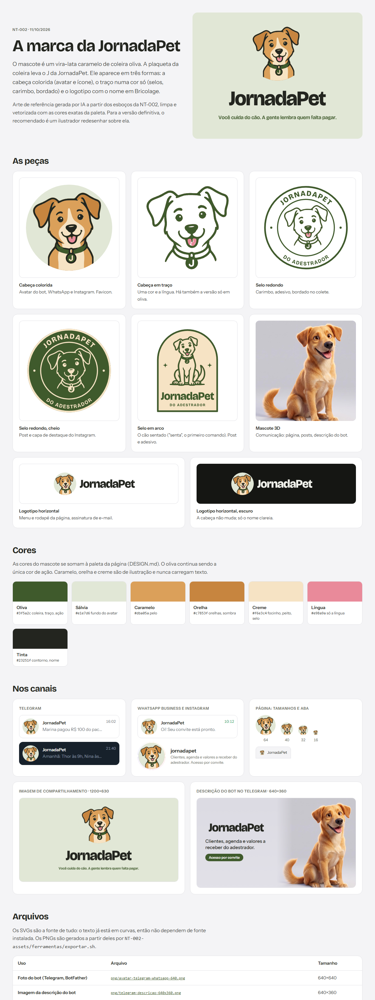
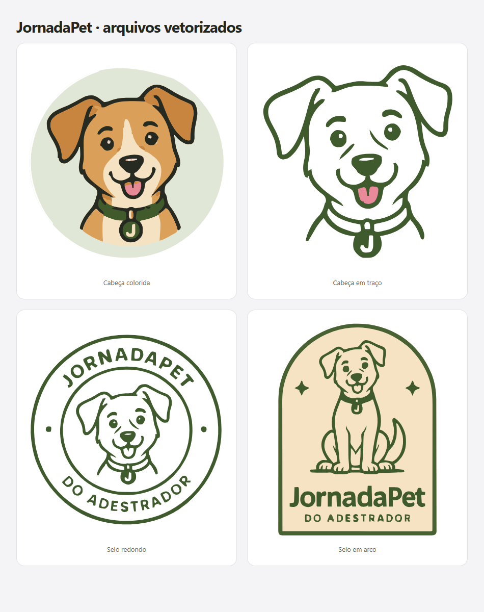

# NT-002 — Marca da JornadaPet: mascote, símbolo e arquivos por canal

**Data:** 2026-10-11
**Versão:** nenhuma — identidade visual, sem código de produto
**Arquivos:** `docs/notas-tecnicas/prototipos/NT-002-marca.html` (folha da marca, vigente),
`docs/notas-tecnicas/prototipos/NT-002-assets/` (SVG, PNG, fontes e ferramentas),
`docs/notas-tecnicas/prototipos/NT-002-exploracao.html` e `NT-002-esboco.html` (histórico)

Folha da marca: [`prototipos/NT-002-marca.html`](prototipos/NT-002-marca.html) ·
Exploração (rodadas A a M): [`prototipos/NT-002-exploracao.html`](prototipos/NT-002-exploracao.html) ·
Esboço em código: [`prototipos/NT-002-esboco.html`](prototipos/NT-002-esboco.html) ·
Contexto de marca anterior: [NT-001 §10](NT-001-landing-page.md#10-análise-de-branding-11102026) ·
Design system: [`DESIGN.md`](../../DESIGN.md)

Links compartilháveis (claude.ai, privados até serem compartilhados pelo menu Share):
exploração <https://claude.ai/artifact/786HoyW7mpovEoSmBBz1x5> · esboço
<https://claude.ai/artifact/RDAoFj6o1AVMVHtpxQoc1N>.

⚠️ **Nota escrita antes da implementação.** Registra a marca escolhida, o caminho até ela, as
direções descartadas e o que ainda falta. O DESIGN.md, a NT-001, o protótipo da landing e o plano
**não** foram alterados aqui; a sessão da landing os atualiza a partir desta nota.

## 1. Pedido

Logotipo para usar no app do Telegram, no WhatsApp, no Instagram e na página. Feito em conjunto
(design, UX e branding), partindo do que a NT-001 §10 já tinha decidido: grafia "JornadaPet",
endosso da ArrayOf, símbolo "J-guia" como esboço, oliva como cor de ação, nunca azul.

## 2. Decisão

**A marca é um mascote: um vira-lata caramelo de coleira oliva, com a plaqueta do J.**

- **Cabeça colorida** sobre sálvia: avatar do bot, WhatsApp, Instagram e favicon.
- **Traço numa cor só**: selo redondo (carimbo, colete, adesivo), selo em arco com o cão sentado
  (post, adesivo), cabeça em traço.
- **Logotipo**: cabeça + "JornadaPet" em Bricolage Grotesque 800, horizontal (menu, rodapé) e
  empilhado com a frase "Você cuida do cão. A gente lembra quem falta pagar."
- **Mascote 3D**: comunicação (página, posts, descrição do bot).
- O cão sentado é o "senta", o primeiro comando do adestramento. A plaqueta com o J liga o mascote
  ao nome e substitui o símbolo "J-guia" da NT-001.

## 3. Como chegamos aqui

Rodadas na prancha de exploração ([`NT-002-exploracao.html`](prototipos/NT-002-exploracao.html)):

| Rodada | O que foi mostrado | Resultado |
|---|---|---|
| 1 | A J-guia refinado · B Pata-J · C Plaqueta · D o J no nome | O Thiago pediu outra direção e mandou referências de petshop (pata, cores fortes, letras com bicho) |
| 2 | E Trajeto · F Caderno · G j com check · H Balão · I Monograma JP | Interesse no I |
| 3 | I + pata (JP com dedos em cima): I+4, I+3, I+C | "Com as bolinhas em cima para simbolizar a pata" |
| 4 | L1 a L3, o JP em traço fino, no estilo das referências de linha | Referência nova: mascote com contorno |
| 5 | M, mascote vira-lata caramelo sentado | **Escolhido**, com o mascote 3D do Thiago como base |

Depois da escolha:

1. Esboço do mascote em SVG feito à mão ([`NT-002-esboco.html`](prototipos/NT-002-esboco.html)),
   com selo redondo, selo em arco e ícone em traço a pedido do Thiago (referências de selos de
   petshop).
2. O Thiago passou o esboço para uma IA de imagem (Codex), que devolveu a arte de referência
   ([`fontes/arte-referencia-ia.png`](prototipos/NT-002-assets/fontes/arte-referencia-ia.png)).
   **A arte foi aprovada.**
3. A vetorização automática do Codex tinha defeitos (abaixo). Foi refeita com limpeza, e o
   resultado são os SVGs em `NT-002-assets/svg/`.

## 4. Limpeza da arte

Defeitos da vetorização automática e o que foi feito:

| Defeito | Correção |
|---|---|
| Fundo da cabeça colorida não era círculo (borda torta, lasca branca) | Círculo geométrico com recorte (`clipPath`); o peito foi prolongado até a borda |
| Dois riscos assimétricos na cara (sobra da mancha do focinho), lidos como cicatriz ou piscada | Apagados antes de vetorizar |
| Contornos tremidos e com espessura irregular | Ampliação 4×, suavização e filtro de moda antes de vetorizar |
| Cores aproximadas e manchas rosadas no brilho do nariz e dos olhos | Cada pixel encaixado na cor exata da paleta; rosa só em área contínua (a língua) |
| "JornadaPet" do selo em arco numa letra inventada pela IA | Texto refeito em Bricolage Grotesque e convertido em curvas |
| Selos com aros e arco traçados à mão | Aros, arco e estrelas refeitos em geometria exata |

A ferramenta está em [`NT-002-assets/ferramentas/`](prototipos/NT-002-assets/ferramentas/):

- `limpar.py` lê os recortes em `fontes/` e grava `svg/`. Vetoriza cada cor numa camada
  empilhada (cada camada é a união dela com as de cima), então não sobra fresta entre cores.
- `fonte.py` converte texto em Bricolage em curvas, em linha reta ou em arco. Baixa a fonte (OFL)
  na primeira execução.
- `exportar.sh` gera os PNGs com o Chrome headless; `comp/` tem as composições da imagem de
  compartilhamento e da descrição do bot.
- Dependências: `pip install numpy pillow scipy vtracer fonttools`.

## 5. Cores

As cores do mascote entram na paleta como **cores de ilustração**. Nenhuma delas carrega texto, e o
oliva continua sendo a única cor de ação.

| Nome | Hex | Uso |
|---|---|---|
| Oliva | `#3f5a2c` | Coleira, plaqueta, traço, selos, ação |
| Sálvia | `#e1e7d6` | Fundo do avatar |
| Caramelo | `#dba05a` | Pelo |
| Orelha | `#c7853f` | Orelhas e sombra |
| Creme | `#f6e3c4` | Focinho, peito, fundo do selo em arco |
| Língua | `#e98a9a` | Só a língua |
| Tinta | `#23251f` | Contorno e nome |

**Mudança em relação ao DESIGN.md:** o caramelo da paleta era `#d17c3a`. O mascote usa
`#dba05a`, mais claro e dourado, como o cão 3D. Proposta: o token `caramelo` passa a `#dba05a` e
`orelha` e `creme` entram como tokens novos. Decisão da sessão da landing ao atualizar o
DESIGN.md.

## 6. Arquivos por canal

| Canal | Arquivo (`NT-002-assets/`) | Tamanho |
|---|---|---|
| Telegram, foto do bot (BotFather `/setuserpic`) | `png/avatar-telegram-whatsapp-640.png` | 640×640 |
| Telegram, imagem da descrição (`/setdescriptionpic`) | `png/telegram-descricao-640x360.png` | 640×360 |
| WhatsApp Business, foto de perfil | `png/avatar-telegram-whatsapp-640.png` | 640×640 |
| Instagram, foto de perfil | `png/avatar-instagram-1080.png` | 1080×1080 |
| Instagram, posts e destaques | `png/selo-redondo-1080.png`, `png/selo-redondo-oliva-1080.png`, `png/selo-arco-810x1080.png` | 1080 e 810×1080 |
| Página, favicon | `svg/cabeca-colorida.svg`, `png/favicon-32.png`, `png/favicon-16.png` | SVG, 32, 16 |
| Página, ícone iOS | selo redondo sobre o fundo da página (`public/apple-touch-icon.png`) | 180×180 |
| Página, manifest | selo redondo, 80% da área (zona segura) (`public/icon-192.png`, `public/icon-512.png`) | 192, 512 |
| Página, imagem de compartilhamento | `og-1200x630.png` com o selo no lugar da cabeça (`public/og.png`) | 1200×630 |
| Página, seção Sobre | `png/selo-redondo-1080.png` e `selo-redondo-oliva-1080.png` (tema escuro), a 128px | 128 |
| Página, menu e rodapé | `svg/logotipo-horizontal.svg`, `svg/logotipo-horizontal-escuro.svg` | vetor |

- Os avatares e ícones são **quadrados com fundo sálvia opaco**. Telegram, WhatsApp, Instagram,
  iOS e Android recortam sozinhos.
- O texto dos SVGs está em curvas: não dependem de fonte instalada.
- Outros SVGs: `cabeca-colorida-quadrada`, `cabeca-traco`, `cabeca-traco-uma-cor`,
  `cao-sentado-traco`, `selo-redondo`, `selo-redondo-oliva`, `selo-arco`, `logotipo-empilhado`,
  `nome`, `nome-escuro`, `nome-oliva`.

## 7. Regras de uso

- A cabeça colorida sobre sálvia vai em todo avatar redondo.
- O traço numa cor só (oliva ou creme) vai em carimbo, adesivo e bordado.
- A coleira oliva e a plaqueta do J aparecem em toda versão do mascote.
- "JornadaPet" é escrito junto, com P maiúsculo, no feminino.
- O selo redondo não é usado abaixo de 96px.
- Nada de azul na marca. Nenhum texto em caramelo, orelha ou creme sobre fundo claro.

## 8. Direções descartadas

- **J-guia (A), símbolo da NT-001.** Sóbrio e de ofício, mas não diz "pet". A argola some em 16px.
- **Pata-J (B).** Pata é o símbolo de milhares de petshops; difícil de registrar.
- **Plaqueta (C).** Virou detalhe do mascote (a plaqueta da coleira).
- **O J no nome (D).** Era a recomendação até as referências de mascote; o Thiago preferiu um
  personagem.
- **E a I e rodadas 3 e 4.** Trajeto, caderno, check, balão e o monograma JP com pata; o
  monograma foi o mais forte, mas perdeu para o mascote.

**Tensão registrada:** a NT-001 §10 pedia uma marca menos "fofa". O mascote é amigável por
escolha do Thiago. O contrapeso está no ofício: o "senta", a coleira de trabalho em oliva e o
selo "do adestrador".

## 9. Pendências

1. **Origem e direitos das imagens.** Confirmar que o mascote 3D e a arte de referência foram
   gerados por IA pelos sócios, e não tirados de banco de imagem.
2. **Arte final por ilustrador** (recomendado): redesenhar sobre a arte de referência, com versão
   própria para 16px.
3. **INPI, Registro.br e os @** no Telegram (@JornadaPetBot?) e no Instagram (@jornadapet?):
   ainda não verificados (NT-001 §10.3).
4. **Atualizar DESIGN.md, NT-001, protótipo v2 e plano** (Tarefas 5 e 11): favicon, símbolo do
   menu e rodapé, avatar do bot na conversa do hero e imagem de compartilhamento. É trabalho da
   sessão da landing.
5. **Nome do mascote.** "Caramelo" é provisório.
